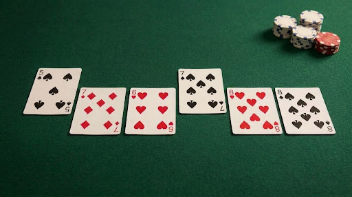

# Last Suit Standing

**An AI research project:** a five-minute card game, solved exactly, for measuring where trained models and standard tests go wrong.

*One Card to Rule Them All.*

> ⓘ The cards are dealt face up at random. After that the game is deterministic: both players see every card, and nothing random happens during play.



*The deal 5♠ 7♦ 6♥ 7♠ 8♥ 8♠. Played perfectly, it includes both swaps, a trump card and pairs on both sides, and Player 1 wins 86 to 83.* [Play this hand.](https://rob-mccormack.github.io/last-suit-standing/)

A five-minute card game for two players that is also an exact laboratory for AI research. A few end-of-game rules (a trump-setting last card, a final swap, doubled scoring) reach backward and overturn local reasoning: the obvious move is usually right, and badly wrong when it isn't. Trained models learn the surface patterns, not the logic of the ending. Most AI testing can only estimate blind spots like this; because this game is solved exactly, they are measured directly against ground truth.

**Why a small game.** Large AI systems have no exact ground truth, and the simplest toy problems have no opponent. Last Suit Standing keeps a real opponent and multi-step strategy while staying small enough to solve.

## Rules in brief

Six cards from a 40-card deck (ace to 10 in four suits) are dealt face up. A card's value is the number on it, and points scored during play are kept as poker chips. Players take turns offering two neighboring cards; the opponent takes one and takes chips equal to its value, while the offerer takes chips equal to the value of the card left behind, which stays in the row. The last card sets trump and scores once more for the last offerer. Each player then gets one chance to swap one card with the opponent's stack. Finally, stack cards score their values again, doubled for trump and doubled for matching pairs (×4 for both).

Most points wins. A game takes about five minutes. [Full rules](RULES.md)

## In brief

- A perfect opponent found only about 60 to 70 percent of the points a worst-case opponent could take from a trained model.
- In about one game in six, the perfect-opponent test found nothing wrong, and the worst-case opponent still took points.
- One well-chosen mistake per game found the exact worst case in about 9 games out of 10.
- Testing against strong play is already known to miss weaknesses. This game measures how much.

## Main findings

Small neural networks and gradient-boosted trees were trained from scratch on the solver's exact values, then tested against perfect play. For the later experiments, the predictions were committed to git before the runs, and misses are reported alongside hits.

**1. Longer optimization on 6-card games hurts 7-card play.** In the original scaling run, a neural network trained on more 6-card games got better at 6 cards and, by the largest training set, worse at every other card count. At 7 cards the loss rose at every step, ending 65% worse than an untrained greedy player, while a held-out 6-card test would have picked it as the best model. ([scaling.md](experiments/scaling.md)) With early stopping off, 7-card loss still rose at every matched pass, and on 8 cards those nets improved at passes 160 and 200. A pass over 4,000 deals is about sixteen times as many Adam updates as a pass over 250 deals. At a matched update count, more deals lowered 7-card loss, by 0.99 points from 250 to 4,000 deals at about 10,000 updates. Training that 4,000-deal net from about 10,000 updates to about 40,000 raised the 7-card loss by 0.61 points. ([checkpoint.md](experiments/checkpoint.md), [matched_steps.md](experiments/matched_steps.md)) The trees, which had stayed flat when they were allowed to stop early, also got worse at 7 cards with early stopping off.

**2. One more card fools the models.** Models trained on 6 cards fail worst on 7 cards, the nearest size, because odd card counts reverse who makes the last offer. Adding 7-card games to training made 8-card play worse, in both model types, and two explanations for this were tested and failed. ([size_shift.md](experiments/size_shift.md), [follow-ups](experiments/size_shift_followup.md))

**3. A perfect opponent underestimates weakness.** Testing against an optimal opponent found only 59–70% of the points an exact worst-case opponent extracts. Measured the stronger way, the cost of a one-sentence rule change doubled, to 4.4 points per game. ([rule_shift.md](experiments/rule_shift.md), [rule_shift_exploit.md](experiments/rule_shift_exploit.md))

**4. Equally perfect choices are not equally safe.** In 15% of deals, opening moves that are exactly tied under the current rules differ by up to 42 points after a rule change. No test under the current rules can tell them apart. ([hidden_gap.md](experiments/hidden_gap.md))

**Other results.** Trained models miss that an ace's suit matters more than a 10's, because the ace usually sets trump ([ace_effect.md](experiments/ace_effect.md)). Elo ranked six players in their true order ([elo.md](experiments/elo.md)). Three rule variants were tested for balance (see [VARIANTS.md](VARIANTS.md)).

## What the solver shows about the game

From 3,000 random deals with perfect play on both sides (`python3 solver.py --deals 3000 --seed 1`):

- **Player 1 has the edge:** 61.4% wins, 8.2% ties, 30.5% losses. An AI that wrote its own solver from `RULES.md` alone found the same.
- **One sentence decides who is favored.** If the second swapper may only undo the first swap, Player 1's wins fall to 35.5%.
- **The card count decides it too.** With an odd number of cards, Player 2 makes the last offer and wins about 98% of deals.
- **Low cards decide trump.** Higher cards tend to be taken, so low cards survive to the end. Taking the *lower* card is the best move in 11.1% of real choices.
- **Lookahead pays.** Against a perfect opponent, a greedy Player 1 wins 31.7% instead of 61.4%.

More in [basic_stats_results.txt](experiments/basic_stats_results.txt).

## Quick start

```bash
python3 solver.py 5S 7D 6H 7S 8H 8S     # solve a deal and show perfect play
python3 solver.py --deals 3000           # statistics over random deals
```

The solver needs only Python 3.8 or later. The experiments that train models also need `numpy` and `scikit-learn`.

## Related projects

Last Suit Standing is one of three small, exactly solved games used to find where AI and its evaluations go wrong ([THREE_PROJECTS.md](THREE_PROJECTS.md)):

- **Collapse3**, a solved 3-D placement game with removal and gravity, studies how standard tests make weak AI look strong. Finding 3 above replicates its "beat the best" result in milder form; see [COLLAPSE3.md](COLLAPSE3.md).
- **PSDG**, a dice game, studies what happens when a perfect plan is locked in and the opponent goes off-script.

## Files

**The game**

| File | What it is |
| --- | --- |
| [RULES.md](RULES.md) | The official rules, clarifications and a worked example |
| [VARIANTS.md](VARIANTS.md) | Rule variants used for research and design testing (not part of the standard game) |
| [solver.py](solver.py) | Exact solver: perfect play for any deal, statistics, brute-force check |
| [solver.md](solver.md) | How the solver works, its options, and how it was verified |

**Experiments**

| File | What it is |
| --- | --- |
| [experiments/scaling.md](experiments/scaling.md) | More 6-card training makes other card counts worse (pre-registered) |
| [experiments/checkpoint.md](experiments/checkpoint.md) | Early stopping off: finding 1 still stands at 7 cards. Trees get worse too. (pre-registered) |
| [experiments/matched_steps.md](experiments/matched_steps.md) | At matched Adam updates, more 6-card deals lowered 7-card loss. Longer training of the same net still raised it. (pre-registered) |
| [experiments/size_shift.md](experiments/size_shift.md) | Transfer from 6 cards to 4–8 cards follows parity |
| [experiments/size_shift_followup.md](experiments/size_shift_followup.md) | Explanations tested, a positive control, robustness across seeds and model types (pre-registered) |
| [experiments/slot_free.md](experiments/slot_free.md) | Slot-free rerun of findings 1 and 2. Finding 2 survives for the trees. The neural net failed the fairness check. (pre-registered) |
| [experiments/component_repair.md](experiments/component_repair.md) | Replacing offers with perfect play cuts more of the loss than replacing choices, with the slot-free encoding. (pre-registered) |
| [experiments/rule_shift.md](experiments/rule_shift.md) | How much a trained network loses when the swap rule changes |
| [experiments/rule_shift_exploit.md](experiments/rule_shift_exploit.md) | The same networks graded by stronger testers, up to the exact worst case |
| [experiments/hidden_gap.md](experiments/hidden_gap.md) | Equally optimal openings that are not equally robust |
| [experiments/ace_effect.md](experiments/ace_effect.md) | Trained models miss that an ace's suit matters more than a 10's |
| [experiments/elo.md](experiments/elo.md) | Does Elo rank players in their true order? (pre-registered) |
| [experiments/straight_rule.md](experiments/straight_rule.md) | A straight variant: its effect on perfect play and on learning (pre-registered) |
| [experiments/wild_rule.py](experiments/wild_rule.py), [jacks_rule.py](experiments/jacks_rule.py) | Wild-card variants: exact effect on perfect play |
| [experiments/basic_stats.py](experiments/basic_stats.py) | Basic facts about perfect and greedy play |

**The project**

| File | What it is |
| --- | --- |
| [THREE_PROJECTS.md](THREE_PROJECTS.md) | How PSDG, Collapse3 and Last Suit Standing fit together |
| [COLLAPSE3.md](COLLAPSE3.md) | What replicates from Collapse3, what differs, what is new |
| [llms-full.txt](llms-full.txt) | The whole repository in one file, to upload to an AI model. Rebuild with `python3 tools/make_llms_full.py` |

## License

MIT. See [LICENSE](LICENSE).
